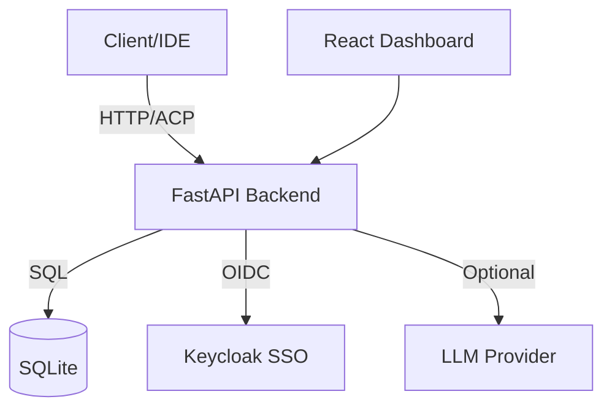

# Orbit Observatory — Ryan Vo

> Work in progress. This checkpoint may be incomplete or fail tests. See PLAN.md and STATUS.md before use.


**Ryan Vo | AI & Machine Learning**

A context-compression plugin for month-long single sessions (billions of tokens), small context windows (100K context is enough), and token savings (5x fewer tokens).

## Problem

Long-running AI conversations accumulate billions of tokens, exceeding context windows and wasting tokens. Existing compression approaches either lose critical context or fail gracefully when fold anchors drift.

## Approach

Orbit Observatory implements a deterministic offline compression engine with:

- **Fold/Unfold**: Compress message ranges into summaries with anchored references
- **Search Context**: Retrieve relevant folded content without full decompression
- **Graceful Degradation**: Detects mass fold-coverage loss and resets dead state instead of looping
- **TRAE Interception**: Catches native IDE compression commands and routes through ACP
- **Fork Inheritance**: Recovers compression state from parent sessions on clone/fork
- **Dry-run Preview**: Validate compression ranges and estimate savings before committing

All compression works offline without LLM keys. LLM explanations are opt-in, labeled advisory, and grounded in actual records.

## Architecture



## Quick Start

### Prerequisites

- Python 3.12+
- Node 24+
- Docker & Docker Compose (for full stack)

### Local Development

```bash
# Backend
cd backend
python -m venv .venv
source .venv/bin/activate
pip install -r requirements.txt
cp ../.env.example .env
uvicorn backend.app.main:app --reload --host 127.0.0.1 --port 8000

# Frontend (separate terminal)
cd frontend
npm install
npm run dev

# Full stack with Docker
docker compose up --build
```

Access:
- Frontend: http://localhost:3000
- Backend API: http://localhost:8000/api
- Health: http://localhost:8000/api/health
- Keycloak: http://localhost:8080 (admin/admin)

### Test Users

| Username | Password | Role |
|----------|----------|------|
| admin | admin | admin |
| operator | operator | operator |
| viewer | viewer | viewer |

## Running Tests

```bash
# Backend tests
cd backend
source .venv/bin/activate
PYTHONPATH=. pytest backend/tests -v

# Frontend tests
cd frontend
npm test
```

## API Endpoints

### Health
- `GET /api/health` - Service health check

### Compression
- `POST /api/compress` - Compress message range
- `POST /api/decompress` - Decompress folded range
- `POST /api/search` - Search folded/unfolded content
- `POST /api/acp_status` - Get compressible spans and protected zones
- `POST /api/acp_cache` - Get ACP cache entries

### Authentication
- `POST /api/login` - Login with username/password
- `POST /api/logout` - Logout
- `POST /api/refresh` - Refresh access token
- `GET /api/me` - Get current user info

## Security

- OIDC authorization-code flow with PKCE
- JWT tokens validated for signature, issuer, audience
- HttpOnly SameSite cookies with CSRF protection on writes
- Role-based access: viewer / operator / admin
- No hardcoded auth bypass in production
- LLM keys server-side only, never in frontend

## AI/ML Evaluation

This product implements a **deterministic context compression engine** for long-running AI sessions. The core algorithm:
- Folds message ranges into anchored summaries with token counting
- Preserves protected zones (recent-N, last user message, protected tools)
- Detects fold-coverage loss and degrades gracefully (reset or short-circuit)
- Provides dry-run preview for validation without side effects

**Reproducible baseline**: Run `pytest backend/tests/test_compression.py::test_compress_fold_unfold_cycle` to verify fold/unfold preserves content.

**Limitations**: LLM-based summarization is opt-in and advisory only. The deterministic core works without any LLM credentials. Prefix cache seam detection on the responses wire is a known issue (upstream).

## Configuration

| Variable | Description | Default |
|----------|-------------|---------|
| `OIDC_ISSUER_URL` | Keycloak realm URL | `http://localhost:8080/realms/orbit` |
| `OIDC_CLIENT_ID` | OIDC client ID | `orbit-observatory` |
| `OIDC_CLIENT_SECRET` | OIDC client secret | *(required)* |
| `COMPRESS_MODEL_CONTEXT_LIMIT` | Model context window | `100000` |
| `TRAE_COMPACT_ENABLED` | Enable TRAE interception | `true` |

See `.env.example` for all options.

## SSO/SAML Setup

Keycloak supports upstream SAML IdPs through identity brokering. Configure in Keycloak Admin Console:
1. Identity Providers → Add SAML v2.0
2. Map SAML attributes to realm roles
3. Update `OIDC_ISSUER_URL` if using external IdP

## License

MIT Copyright Ryan Vo <ryandtvo@gmail.com>